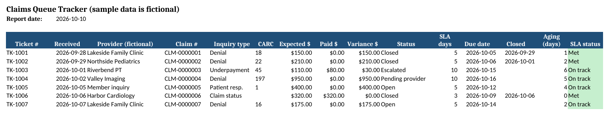

# Gabriel Díaz
### Medical Claims & Provider Services Specialist

-1F4E78)

📧 [venitololo428@gmail.com](mailto:venitololo428@gmail.com) · 💼 [LinkedIn](https://linkedin.com/in/gabriel-diaz-2619b8345) · 🖥️ [IT Support Portfolio](https://github.com/venitololo428-pixel/IT-support-portfolio)

---

I resolve **medical claims and provider inquiries for U.S. health plans**: investigating denials and payment discrepancies, coordinating with providers, and documenting every case so it holds up in an audit. Over 3+ years in U.S.-facing BPO operations I have worked **both sides of benefits**: health insurance claims and billing, and 401(k) / Annual Enrollment administration for large U.S. employers.

**Roles I'm targeting:** Claims Specialist · Claims Examiner / Processor · Provider Services Representative · Medical Billing & AR Follow-up · Benefits Administration

## What I bring to your team

| | |
|---|---|
| ✅ **Claims resolution** | Denials, underpayments, COB, authorization and eligibility issues: root cause found, explained clearly, fixed or escalated |
| ✅ **High-volume queue work** | Ticket queues worked by SLA and aging, with quality and compliance standards met |
| ✅ **Audit-ready documentation** | Short, factual case notes: what was asked, what I found, what I did, what happens next |
| ✅ **HIPAA & sensitive data** | Daily handling of PHI, Social Security numbers and payment data with verification and minimum-necessary disclosure |
| ✅ **Bilingual service** | Native Spanish, advanced English (C1), working U.S. hours from Panama (same time zone as EST) |
| ✅ **Excel & systems** | CRM and ticketing systems, Excel (pivot tables, VLOOKUP, formulas), fast and accurate data entry |

## Experience

**First Enroll** · Panama City
- **Provider Services & Claims Resolution** *(current)*: resolve provider inquiries and claims tickets in a high-volume queue; investigate claims discrepancies and coordinate with providers; document resolutions for audit and follow-up
- **Accounts Payable Specialist**: supported U.S. health insurance customers in English; processed premium payments and resolved billing issues; explained policy details and coverage; documented all interactions in CRM

**Foundever (Alight account): 401(k) Defined Contribution Specialist** · Panama City
- Managed 401(k) plans for several large U.S. employer clients
- Verified employee benefit data across multiple systems and supported **Annual Enrollment**
- Handled Social Security data under strict privacy rules; **exceeded KPIs** for call resolution and processing

**Alorica (Best Buy account): Customer Service Agent** · Panama City
- Maintained customer records with high accuracy; processed card and membership data confidentially; met performance targets

## ⏱️ Have 2 minutes? Start here

| If you want to see… | Open |
|---|---|
| How I investigate and document real-world claim problems | 📂 [**5 case studies**](./docs/case-studies) *(de-identified)* |
| That I can explain every dollar on a remittance | 🧾 [**EOB walkthrough**](./docs/eob-walkthrough) |
| How I handle the most common denials | 📋 [**Denials playbook**](./docs/denials-playbook) |
| How I protect PHI on every contact | 🔒 [**HIPAA practices**](./docs/hipaa-compliance) |

## Full portfolio

| Section | What it shows |
|---|---|
| [Claims lifecycle](./docs/claims-lifecycle) | How a claim moves from visit to payment, claim forms, code sets, and my research order for a ticket |
| [EOB walkthrough](./docs/eob-walkthrough) | A remittance explained line by line, and how I explain it to a provider and to a member |
| [Denials playbook](./docs/denials-playbook) | Common CARC denials and payment discrepancies with root cause, checks and next action |
| [Case studies](./docs/case-studies) | Duplicate denial, COB, underpayment against contract, authorization mismatch, deductible error |
| [Provider services workflow](./docs/provider-services) | Authentication, inquiry types, escalation criteria and documentation standard |
| [HIPAA practices](./docs/hipaa-compliance) | Verification, minimum necessary, and social-engineering red flags |
| [401(k) & Annual Enrollment](./docs/benefits-401k) | Benefits administration experience and how it connects to claims |
| [Glossary](./docs/glossary) | Claims and benefits terms used in this portfolio |
| [Templates](./templates) | Claims queue tracker (Excel) and case-note template |

### Claims queue tracker (Excel)

[Download the tracker](./templates/claims-queue-tracker.xlsx). It calculates due dates in business days, ticket aging and SLA status automatically, highlights overdue tickets, and summarizes volume, SLA compliance and root causes. *Sample rows are fictional.*

## Skills

**Claims:** CMS-1500 / UB-04 · CPT, HCPCS, ICD-10 and modifiers (working level) · CARC / RARC · EOB / ERA (835) · COB · eligibility & benefits · prior authorization · timely filing · corrected claims & appeals · reprocessing requests

**Operations:** ticket queues & SLAs · provider and member communication · escalation · payment processing · accounts payable · data verification

**Tools:** CRM & ticketing systems · Microsoft Excel (pivot tables, VLOOKUP, data cleaning) · Google Sheets & Docs · Microsoft Teams · Slack · Zoom · Trello

## Education

- **B.Sc. Systems Engineering**, Universidad Humboldt *(in progress)*
- **Google IT Support Professional Certificate**
- High school diplomas in Science and Commerce, Instituto Sun Yat Sen

**Languages:** Spanish (native) · English (C1) · Chinese (basic) · Japanese (basic)

---

> 🔒 **About the data in this repository:** every case, name, ID and amount here is fictional. The cases mirror the *types* of issues handled in claims work, never real records. No member, patient, provider or client data is shared.

**Let's talk:** [venitololo428@gmail.com](mailto:venitololo428@gmail.com) · [LinkedIn](https://linkedin.com/in/gabriel-diaz-2619b8345)
